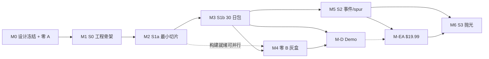

# 里程碑与验收总表

> **单一索引**：节点顺序、过线标准、命令与权威细节出处。  
> 基线：设计 **v1.3.33** / 规格 **v1.52** / 实体 `configVersion` **30**（冻结闸 **config25**）/ `version.save` **12**  
> 缺口：[OPEN_LOOPS](OPEN_LOOPS.md) · 风险：**DR1–DR7**（≠ 08 玩家 R1–R6）

---

## 1. 总览路线图

| 里程碑 | 含义 | 当前状态（2026-11-26） |
|---|---|---|
| **M0** | 规则闭环 + 数值冻结 + sim 闸 | **过**（主闸 #2/#6/#8；#5/#7 **~**） |
| **M1** | Godot 可跑、ConfigDb、Autoload | **部分**（S0.1–2 **过**；S0.3–5 / `run_main` **部分**；证据 [qa/整体审计报告-第四轮.md](../qa/整体审计报告-第四轮.md)） |
| **M2** | S1a 可录屏闭环 | **部分**（S1a.1–7 代码 **部分**；自动化已删；§12.6 录屏/人工未签） |
| **M3** | S1b 关 L8「30 日无阻断」 | **未过** |
| **M4** | 零 B 真人灰盒 | **包就绪 · 场次搁置** |
| **M5** | Incident 叙事 + spur + 战斗加厚 | **Incident S2 进行中 · legacy 卡冻结** |
| **M6** | 全价前抛光（TIPS/多语言/埋点/异能等） | **未起** |
| **M-D** | **Steam Demo** 公开发布 | **未起** |
| **M-EA** | **Early Access** $19.99 上架 | **未起** |

**冻结政策**：M0 后 **不**为对表改乘子；改数走 [10 §1.1](10-validation.md) 解冻。**详表不重复**，见下链各节。  
**商业节点**：M-D / M-EA 见 **§9–§10**（与 M3–M5 有硬前置，不可跳闸）。

---

## 2. M0 · 设计冻结与阶段零 A（sim）

**目标**：`data/` 与模块正文一致；自动模拟证明主数值闸可过，**不等同**可玩客户端。

| 验收项 | 过线（config 25） | 验证方式 | 权威 |
|---|---|---|---|
| 配置交叉校验 | `ConfigDb` 缺表报错 | 手工 / 临时脚本 | [09 §1](09-data-platform.md) |
| 零 A 十项主闸 | 见下表 **状态** | 解冻时重做 runner | [10 §1](10-validation.md) |
| 数值冻结 | 不改 F04/季节/开局乘子 | 主策 §1.1 | [10 §1.1](10-validation.md) |
| 手算 #9/#10 | 主策签字（条件过） | 纸面/表 | [10 §1.2](10-validation.md) |
| AUDIT K 记录 | 保守/扩张 46%/48% 存活等 | 同上 @500 | [10 §1](10-validation.md) |

**零 A 十项速查**（完整条文见 [10 §1](10-validation.md)）：

| # | 要点 | config25 闸 | 状态 |
|---|---|---|---|
| 1 | 无 NaN/负库存 | 引擎 clamp | ~ |
| 2 | 存活≥120d | 各策略 **≥40%** | **过** |
| 3 | 死因结构 | 单因 ≤70%；非战 ≥2 类 | **过** |
| 4 | 四线科技 | Lv1–3 各 ≥5% | **过** |
| 5 | 进站保底 | drought≥8 ≤10%；`guaranteeAfter=4` | ~ |
| 6 | 扩张对比 | pop20 Δ≥5pp 或 beds20 | **过** |
| 7 | 搜索 | 单点均值 ≤3 | ~ |
| 8 | 240d 人口 | 扩张 pop20 ≥30% 等 | **过** |
| 9 | 冬季燃料 | 手算收支 | 条件过 |
| 10 | 冬季食物 | 手算 30 日 | 条件过 |

**出口标准（M0 完成）**：主策接受 config25 冻结 + 零 A 主闸过线 + §1.2 手算流程齐（签字可后补）。

---

## 3. M1 · S0 工程骨架（Godot）

**目标**：`client/` 与 `data/` 同源；无玩法硬编码；CI 可校验配置。

| ID | 验收标准 | 过线 | 状态 |
|---|---|---|---|
| S0.1 | Autoload：`ConfigDb` / `IntentBus` / `GameSession` / `RngService` / `SaveService` / `TelemetryService` | F5 无报错 | **过** |
| S0.2 | manifest 全表加载（JSON + CSV 本地化） | 删 `weather.json` 后启动必失败 | **过** |
| S0.3 | 教程跨度 / `dayTotal` 可增 | HUD 季日 + 无头 15 日 | **部分**（`GameCalendar` + `hud_top` + `RegionRun`；§12.5 #3 人工签） |
| S0.4 | 开局读 `balance.start.*` | 改 json 可见 | **部分**（含 `precision`/`start`；§12.5 人工） |
| S0.5 | `recomputeClimate` 后倍率随区域 | F3 + `weather_draw` + dev mult | **部分**（F3/F04 可见；§12.5 #4 人工签） |
| M1 出口 | `run_main` 可进局 | `main_scene=run_main` | **部分**（场景 load 冒烟 **过**；§12.5 #1–6 未全签） |

**工程交付**：[`client/`](../client/) · 数据链 [`tools/link_client_data.ps1`](../tools/link_client_data.ps1) · 文档 `python tools/check_doc_consistency.py`  
**权威明细**：[GODOT_ARCH §10 S0](GODOT_ARCH.md) · 与 [开发计划 §14.2.1](../开发计划.md#142-验收标注总表) 同步

**出口标准（M1 完成）**：S0.1–S0.2 **过** + S0.3–S0.5 **过** + M1 出口 **过**（对齐 §14.2.1）。

---

## 4. M2 · S1a 最小可玩切片

**目标**：支撑零 B 与录屏；[10 §2.1](10-validation.md)「构建号」以此为准。

**玩法必须可点出**（[GODOT_ARCH §9.1](GODOT_ARCH.md)）：

1. 时间推进（日/季 UI）  
2. 驾驶：加减速 / `driveIntent` 停靠  
3. 进站 → 发现 → 修复 → 加挂 → 出发（含 `offerDefer` 只读阈值）  
4. 搜索 / 召回；单点搜索 cap（遥测 `search_assign`）  
5. 日结粮水燃料可见（F04 等读 balance）  
6. 供暖开关  
7. 停靠 `ABANDON_CARRIAGE`（[03 §4.1](03-train.md)）；最少 1 节动力 + UI 确认  

| ID | 验收标准 | 过线 | 状态 |
|---|---|---|---|
| S1a.1 | 行驶额度来自 `time.driveHoursPerDayCap` | 额度满→停靠油耗系数 | **部分**（`drive_service` + HUD km；§12.6 录屏） |
| S1a.2 | 进站闭环 + 教程休息车 | 首次有池站可挂 living | **部分**（`station_service` + 面板；人工录屏） |
| S1a.3 | `stations.guaranteeAfter` | 连 miss 后必出可修 offer | **部分**（无头 `guaranteeForced`；人工拒×4） |
| S1a.4 | 搜索入库 | `point_types` 结算可见 | **部分**（点名/堆/搬 + cap 冒烟；[DEV-functional-checklist D](../qa/DEV-functional-checklist.md)） |
| S1a.5 | 日结顺序 | 与 [02 §8](02-resources.md) 一致 | **部分**（0–8 薄接线；工位/收留待加厚） |
| S1a.6 | `SET_HEATING` | 粮/油变化符合 01 §8.1.1 | **部分**（HUD + 3b；无种植车正式场景） |
| S1a.7 | 连续 **15 游戏日** 无软锁 | QA 签字 | **部分**（历史无头已删；[archive DEV-S1a7](../archive/qa-history/DEV-S1a7-soft-lock.md) 未签） |
| E3 | 遗弃确认流 | 最少 1 动力；0.5 日；telemetry | **部分**（UI + 服务；E3–E5 人工） |
| ZA-7 | 单点搜索 cap ≤3 | 均值/sim | **部分**（`SearchRules.cap()`；无 sim 导出） |

**不要求**：L3 战斗、120 事件 UI、L6 全量 TIPS、多语言 UI 齐。

**出口标准（M2 完成）**：S1a.1–S1a.7 **全部过** + E3 **过**；可对外演示「进站—挂车—搜点—过冬感知」。与 [开发计划 §14.2.2](../开发计划.md#142-验收标注总表) 同步。

---

## 5. M3 · S1b 阶段一完成（关 L8）

**目标**：内部 **3 人各满 30 游戏日**无阻断（[OPEN_LOOPS L8](OPEN_LOOPS.md)）。

| ID | 交付 / 验收 | 过线 | 状态 |
|---|---|---|---|
| S1b.1 | S1a 稳定 | 无已知软锁 | 未过 |
| S1b.2 | 区域三选一 | ≥3 词条、雪原可感 | **部分**（冒烟 + [DEV-functional-checklist G](../qa/DEV-functional-checklist.md)） |
| S1b.3 | 四线科技 Lv1 | `upgrades.json` 真实扣费 | **部分**（`tech_service` 四线 Lv1 薄；冒烟动力） |
| S1b.4 | 战斗 L1 | 非「跳过即胜」 | **部分**（`combat_l1` + 四非战路径；L2 未实装） |
| S1b.5 | 本地存档 save **12** | 杀进程不漂；`abandonCount` 缺省 | **部分**（历史 save_kill 证据；F3 槽 0 人工） |
| S1b.6 | data P0+P1 | manifest 全表 | **过** |
| S1b.7 | 08 §4 提示 | 可后置 | 搁置 |
| S1b.8 | **30 日 ×3 人** | 无阻断 | 未过 |
| S1b.9 | 调参可感 | 改 `emptyChance` 进站频率变 | 未过 |

**权威明细**：[GODOT_ARCH §9.2 · §10 S1b](GODOT_ARCH.md)

**出口标准（M3 完成）**：S1b.1–S1b.8 过 + [10 §2.1](10-validation.md) 构建号登记。

---

## 6. M4 · 阶段零 B（真人灰盒）

**目标**：验证「决策可读、油压五腿、先床后人」等 **08 §4** 与正式定量条。

| 类别 | 标准 | 权威 |
|---|---|---|
| 样本 | ≥8 外部玩家 × ≥2 场 × ≥60min | [10 §2](10-validation.md) |
| 流程 | 60–90min 单场表 + 观察员表 + 问卷 | [10 §2.2–2.4](10-validation.md) |
| 定量 | 45min 内首次进站闭环 ≥6/8；决策中位 ≥6/30 日等 | [10 §2](10-validation.md) |
| 探针 B1–B6 | 油五腿、秋储、床位、装甲、雪原空转、供暖 | [10 §2](10-validation.md) |
| 冻结 | 测试期 **不**热更 config25 乘子 | [10 §2.1](10-validation.md) |
| 前置 | **M2 构建**可跑 S1a 闭环 | [GODOT_ARCH §9.1](GODOT_ARCH.md) |

**出口标准（M4 完成）**：主策确认探针与正式条达标 + 签字 §1.2（若尚未签）+ 开测清单勾选。

---

## 7. M5 · S2 事件与 spur

**目标**：自发 incident 进游戏（`useLegacyEventCards=false` 可玩）；气候 immediate；`SystemEffects`；短分岔。Legacy 120 卡 **冻结**，仅对照/旧档。

| ID | 验收 | 过线 | 权威 |
|---|---|---|---|
| S2.1 | Incident 段/日 hook | `stress_sweep.py` OK · types≥8 | [06-incident-migration](06-incident-migration.md) · [GODOT_ARCH §10 S2](GODOT_ARCH.md) |
| S2.1b | Legacy 卡（可选） | `useLegacyEventCards=true` 时季/年池可抽 | `events/_index.json` |
| S2.2 | immediate + delay | 气候即时 recompute | 同上 |
| S2.3 | `spurChance` | 每跨度 ≤1 | [06 §1.4](06-region-events.md) |
| S2.4 | 战斗 L2/L3 加厚 | 按排期 | [05](05-combat.md) |

**出口标准（M5 完成）**：S2.1–S2.3 过 + 内容排期 S2.4 达标。

---

## 8. M6 · S3 抛光与发布准备

| 项 | 标准 | 权威 |
|---|---|---|
| TIPS L6 | 08 §4 表进游戏（可先做 P0） | [08](08-presentation.md) · [OPEN_LOOPS L6](OPEN_LOOPS.md) |
| 多语言 | localization CSV 接 UI | [09](09-data-platform.md) |
| 埋点全量 | 09 §4 + §4.2 草案扩展 | [09](09-data-platform.md) |
| 全价/EA 衔接 | 见 **M-EA** | §10 |
| 定居点等 | **首发不做** | [07](07-endings-meta.md) · L9 |

---

## 9. M-D · Steam Demo 专属

**定位**（[architecture §1](../architecture.md)）：在 **无购买承诺** 前提下，让海外 Steam 用户 **45–90 分钟内**感受到「移动殖民地 + 长度即负担」——油耗、进站发现、扩编压力 **必须在 Demo 内可见**。

**与 M2/M3 区别**：M2/M3 为内部验收；**M-D** 为 **公开构建** + 商店页 + 稳定性与内容 **上限**（防剧透/防 grind）。

### 9.1 前置里程碑（硬闸）

| 闸 | 要求 |
|---|---|
| 玩法 | **M2 过** + **M3 过**（或主策书面豁免项 ≤2 条并登记） |
| 灰盒 | **M4 有条件通过** 或 **通过**；B1/B4 不得「不通过」 |
| 冻结 | Demo 构建基于 **config 25**（或已登记的新 configVersion） |
| 制作阶段 | 对齐 [10 §3](10-validation.md) **阶段四 · Demo** |

### 9.2 内容与范围闸

| ID | 验收标准 | 过线 |
|---|---|---|
| D1 | **核心循环闭环** | 进站→发现→修挂→搜刮→日结→至少 **1 次冬季体感**（可失败结局） |
| D2 | **差异化可见** | 存档/录屏可证明：油耗顶栏、至少 1 次进站发现、节数增加后负担上升（08「长度即负担」或等效 UI） |
| D3 | **事件/战斗上限** | 事件 **≤40 张**（季/年池子集，不曝光全年 120）；战斗 **L1 必可玩**，L2+ **可关或锁** |
| D4 | **进度上限** | 单局 **软顶**：如 `dayTotal ≤ 120` 或首个冬季结束后弹「Demo 止」+ 跳转愿望单；**禁止**无声截断 |
| D5 | **存档** | 允许本地存档 **Demo 独立槽**（或单槽）；**不得**用 Demo 档直接进 EA 全版（若全版同引擎则迁移/清空策略写进发行说明） |
| D6 | **08 §4 P0 提示** | **T1 + T3** 至少启用其一（L6 全表可仍后置） |
| D7 | **性能** | 15 节全景 **≥30 fps**（1080p / GTX1060 级）；对齐 [10 §2](10-validation.md) 灰盒条 |
| D8 | **语言** | 商店页 + 游戏内 **英/简中** 必达；德俄西可 Demo 后补 |

**Demo 明确不做**（与 EA 分界）：异能满轴、120 事件齐、spur 必开、L3 大战、定居点、MOD、云存档。

### 9.3 商店与工程闸

| ID | 验收标准 | 过线 |
|---|---|---|
| D9 | Steam **Demo depot** 构建可重复 | 同 commit 可打出 2 次一致构建号 |
| D10 | 商店素材 | 胶囊图 + 5 张截图 + 15–30s 循环片（展示驾驶/进站/油条） |
| D11 | 崩溃率 | 内部 **≥5 人** 各玩通 Demo 软顶 **0 次软锁、0 次必现崩溃** |
| D12 | 遥测（可选） | `run_start` / `run_end` / `day_pass` 本地或 Steam 可选统计；见 [09 §4](09-data-platform.md) |

### 9.4 上架后观测（非开发闸，主策跟踪）

| 指标 | 用途 | 备注 |
|---|---|---|
| Demo 安装 → 愿望单转化 | 验定位 | [09 §4](09-data-platform.md) 仅参考 |
| 平均游戏时长 | 验 D1/D4 节奏 | 目标带 **45–90min** |
| 首周评论关键词 | B1/B4/B5 探针 | 不解冻数值，改提示/教程 |

**出口标准（M-D 完成）**：D1–D11 过 + Steam Demo **对外可见** + 构建号写入 [10 §2.1](10-validation.md) 式登记表（Demo 专用行）。

---

## 10. M-EA · Early Access 专属

**定位**（[architecture §1](../architecture.md)）：**$19.99** 抢先体验；无尽生存；后续涨至 **$24.99** 全价（全价时机另订）。  
**时机默认**（[10 §4](10-validation.md)）：**核心循环稳定 + 至少 60 张事件卡可玩** 后再开 EA（120 卡可在 EA 周期内增厚）。

### 10.1 前置里程碑（硬闸）

| 闸 | 要求 |
|---|---|
| Demo | **M-D 完成** 且运行 **≥2 周**（或主策豁免并记录原因） |
| 内容 | **M5 至少 S2.1–S2.2 过**；事件 **≥60** 张进池且五语 CSV 无 P0 键洞 |
| 玩法 | **M3 过**；内部 **30 日 ×3** 无阻断 |
| 灰盒 | **M4 通过**（非仅有条件） |
| 手算 | [10 §1.2](10-validation.md) **#9/#10 主策签字** |
| 冻结 | EA 首包 configVersion 登记 + [archive/VERSION.md](../archive/VERSION.md) 一行 |

### 10.2 玩法与内容闸

| ID | 验收标准 | 过线 |
|---|---|---|
| E1 | 核心循环 | [GODOT_ARCH §9.1–9.2](GODOT_ARCH.md) 全项；稳定 **≥30 游戏日** 无软锁（= M3） |
| E2 | 区域 | 三选一 **≥3** 词条；雪原 `regionFuelMult` 可感知 |
| E3 | 事件 | **≥60** 卡；季/年池 + 权重与 sim/sweep 无 P0 冲突 |
| E4 | 战斗 | **L1 完整**；**L2** 至少 1 种威胁模板可复现 |
| E5 | 科技 | 四线 **Lv1–3** 可升（Lv4/5 可标「EA 后续」） |
| E6 | 存档 | `version.save` **12** 全子集；杀进程不漂；迁移链 manifest 对齐 |
| E7 | 表现 | 08 §4 **P0 提示齐**；P1 提示 **≥T1–T5** |
| E8 | 语言 | 商店 + 游戏 **五语** UI 关键路径无裸 key |
| E9 | 红线抽检 | architecture **红线 #1–#13** 抽样 QA 表无 P0 违反 |

### 10.3 商业与合规闸

| ID | 验收标准 | 过线 |
|---|---|---|
| E10 | 定价 | Steam 后台 **$19.99** EA（国区按计划 ¥ 档） |
| E11 | 页面 | EA 说明含：内容缺口、无尽无通关、仅本地存档、反馈渠道 |
| E12 | 无档成长 | 元进度 **仅收藏**（红线 #11）；商店文案不承诺跨局数值 |
| E13 | 构建 | 与 Demo **分 depot** 或分支清晰；版本号 `major.minor.patch` + `configVersion` 随发行说明 |
| E14 | 支持 | 已知问题链 [OPEN_LOOPS](OPEN_LOOPS.md)；EA 首月 **不解冻** 除非 §1.1 解冻流程 |

### 10.4 EA 后首更（非上架闸，路线图）

| 批次 | 内容 | 权威 |
|---|---|---|
| EA+1 | 事件补至 **120**、spur、L2 加厚 | M5 余量 |
| EA+2 | 战斗丰富、创伤/关系内容扩展 | [05 §9](05-combat.md) |
| EA+3 | TIPS L6 全量、埋点上报、MOD 内容包接口 | P3 |

**出口标准（M-EA 完成）**：E1–E14 过 + Steam **Early Access** 状态开启 + 主策/发行签字。

---

## 11. Demo ↔ EA 对照（防 scope 漂移）

| 维度 | M-D Demo | M-EA |
|---|---|---|
| 定价 | 免费 | $19.99 |
| 事件 | ≤40 张（子集） | ≥60（EA 开），目标 120 |
| 战斗 | L1 必达 | L1 + L2 基线 |
| 进度 | 软顶（~120 日或首冬后） | 无尽 |
| 存档 | Demo 槽/隔离 | save 12 完整 |
| 零 B | 有条件通过可上架 Demo | 须 **通过** |
| 数值 | config 冻结 | 冻结；热更走解冻 |

---

## 12. 优先级与制作 P0–P3（对照）

与 [GODOT_ARCH §8](GODOT_ARCH.md) 一致：

| 优先级 | 范围 | 对应里程碑 |
|---|---|---|
| **P0** | 配置、会话、时间、驾驶、进站、日结、最小 UI | M1–M2 |
| **P1** | 三选一、科技 Lv1、存档、L1 战斗 | M3 |
| **P2** | 事件窗、spur、战斗加厚 | M5 |
| **P3** | TIPS、多语言、埋点全量、异能满轴 | M6 |
| **发行 P1** | Steam Demo | **M-D** |
| **发行 P2** | Early Access | **M-EA** |

**推荐执行顺序**：M0 → M1 → M2 → M3 → M4 → **M-D** → M5（与 Demo 后并行加厚）→ **M-EA** → M6。

---

## 13. 建议排期（参考周）

| 周 | 焦点 | 里程碑出口 |
|---|---|---|
| W0 | 已完成：冻结 + sim + client boot | M0 / M1 部分 |
| W1 | S0 补齐 + `run_main` | M1 **部分**（待 §12.5 人工签） |
| W2–3 | S1a.1–S1a.7 + 录屏 | M2 **部分**（手工清单 + 录屏） |
| W4 | S1b + 30 日 | M3 |
| W5+ | 零 B 场次 → S2 | M4 / M5 |
| W* | Demo 包 + 商店 | **M-D** |
| W*+ | EA 首包 | **M-EA** |

---

## 14. 相关文档

| 文档 | 用途 |
|---|---|
| [10-validation.md](10-validation.md) | 零 A/B 全文、冻结、手算、问卷 |
| [GODOT_ARCH.md](GODOT_ARCH.md) | 分层、Intent、S0–S3 细项 |
| [OPEN_LOOPS.md](OPEN_LOOPS.md) | L 缺口、DR 风险、审计 §5 |
| [architecture.md](../architecture.md) | 红线、分层、缩写 |
| [client/README.md](../client/README.md) | 工程启动 |